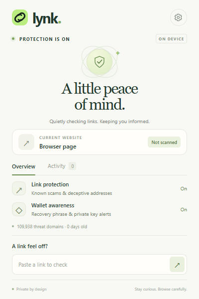

# Lynk

**A quieter guard for your browser and wallet.**

Lynk is a local-first Chrome extension that blocks reported phishing domains, spots familiar-looking URLs with unfamiliar destinations, and warns when a page asks for a recovery phrase or private key. Its compact interface uses warm neutrals, a sage accent, and clear, specific explanations.



## Install locally

Requires **Node.js 22.12+**, npm, and desktop Chrome 120+ (or a compatible Chromium browser).

```sh
npm ci
npm run build
```

1. Open `chrome://extensions`.
2. Enable **Developer mode**.
3. Choose **Load unpacked** and select this repository’s `dist` folder.
4. Pin Lynk using Chrome’s extensions menu.

To create a distributable zip, run `npm run package`. Extract `artifacts/lynk-0.1.0.zip` into a folder and load that folder as an unpacked extension. Chrome does not install a local zip directly. This project has not been submitted to the Chrome Web Store.

## What it does

| Layer            | Behavior                                                                                                                                                                                             |
| ---------------- | ---------------------------------------------------------------------------------------------------------------------------------------------------------------------------------------------------- |
| Reported domains | Chrome-native declarative network rules redirect top-level visits to a warning before the destination loads. Requests for embedded resources from listed hosts are blocked.                          |
| New lookalikes   | Checks transposed letters, missing letters, selected Unicode confusables, brand names on different suffixes, and deceptive subdomains against a curated set of crypto and everyday identity anchors. |
| General URL cues | Explains misleading `user@host` addresses, unencrypted HTTP, numerical hosts, and internationalized domains. An internationalized address is a caution signal, not a phishing accusation.            |
| Link previews    | Hovering a link checks its destination locally. Clicking a known risky preview or a link whose displayed URL names another registered domain opens an in-page warning.                               |
| Recovery fields  | Inspects field labels and attributes for recovery phrases and private keys. Warns before entry and intercepts ordinary form submission until dismissed. Field values are never read.                 |
| Manual checker   | Paste a URL into the popup without opening it.                                                                                                                                                       |
| Local history    | Optional, bounded to 50 warning domains, reasons, and timestamps. Clearing it is immediate. No ordinary browsing history is saved.                                                                   |

The bundled snapshot contains **109,938 domains** from [MetaMask’s eth-phishing-detect](https://github.com/MetaMask/eth-phishing-detect). See [feed metadata](public/data/feed-meta.json) for its pinned revision, retrieval time, and original-content SHA-256. The feed’s fuzzy allowlist exempts spelling comparisons, never an explicit blocklist match. Identity anchor domains are references, not endorsements.

## Honest limits

Lynk cannot promise a website or transaction is safe. A clean URL can host a drainer, and a legitimate site can be compromised. Connecting a wallet, signing typed data, or granting token allowances needs review inside the wallet. Lynk **does not simulate transactions, inspect wallet-extension prompts, revoke approvals, or intercept wallet providers**. It never asks you to connect a wallet.

Only reported-domain rules provide a network-level pre-load block. Heuristic navigation checks are asynchronous and may run after a request starts. In-page warnings and submit interception are best effort: hostile pages can hide fields, remove UI, make direct requests, or use closed shadow DOM. “No flags” means no known URL indicators were found, not a safety certification.

Chrome prevents inspection of internal browser pages, the Chrome Web Store, and other extensions. Incognito needs separate user permission. Site access must remain enabled for automatic page checks and redirects to operate.

Threat intelligence is an **offline release snapshot**, not a live service. The interface flags snapshots older than seven days. New scams can appear before they reach the list. Keep Chrome Safe Browsing and your wallet’s own security alerts enabled.

## Privacy and permissions

There is no backend, analytics, account, API key, remote script, or runtime reputation request. Production code fetches only its own packaged threat JSON. Source URLs in documentation/settings open only when clicked.

| Permission              | Purpose                                                                                                                                                         |
| ----------------------- | --------------------------------------------------------------------------------------------------------------------------------------------------------------- |
| HTTP/HTTPS host access  | Check URLs and page field metadata; redirect known phishing navigations. Chrome shows a broad site-access warning because these functions work across websites. |
| `declarativeNetRequest` | Apply packaged domain rules even while the service worker sleeps.                                                                                               |
| `webNavigation`         | Assess typed URLs and redirects, and retain the blocked destination for the warning screen.                                                                     |
| `storage`               | Local preferences and optional warning history; transient per-tab assessments and overrides in session storage.                                                 |
| `alarms`                | Clean up expired temporary overrides.                                                                                                                           |

Full current URLs are held transiently in **trusted extension session storage** to support warning details and continuation. They are cleared when tabs close or move to non-web pages and when the browser session ends. Persistent warning history contains **hostnames only**. Query strings and fragments are never persisted to disk by Lynk’s history feature. Disabling local history deletes it. Wallet accounts, balances, signatures, and field values are not collected. See [PRIVACY.md](PRIVACY.md).

## Warning overrides

The default action leaves the page. Advanced continuation requires explicit risk acknowledgment and allows only the exact origin in the same tab for up to ten minutes. Other tabs and known dangerous subresources stay protected. The rule is removed on leaving the origin, closing the tab, or expiry; browser alarm scheduling can delay idle cleanup, while the next navigation checks expiry again. Browser restart clears all passes. There is no permanent “trust this scam” list.

## Develop and verify

```sh
npm run check                  # strict TypeScript, unit tests, production build
npx playwright install chromium
npm run test:e2e               # real MV3 extension in Chromium
npm run package               # build and zip
```

The browser suite maps all hostnames to loopback and serves controlled fixtures. It never visits a live phishing server. It checks pre-load blocking, tab-scoped overrides, origin-leave cleanup, lookalikes, UI interactions, privacy of typed secrets, and deceptive link text. Set `LYNK_CHROMIUM_PATH` to reuse a local Playwright-compatible Chromium executable if needed. Screenshots are written to `artifacts`.

```text
src/core/       URL parsing, public-suffix boundaries, signals, scoring
src/background.ts  Trusted state, Chrome-native rules, navigation and messages
src/content.ts     Isolated page checks and restrained warning UI
src/ui/            Popup, settings, and warning controllers
public/            HTML, styles, manifest, pinned threat snapshot
scripts/           Reproducible build, feed refresh, release packaging
tests/             Threat-engine tests and actual extension browser tests
docs/              Research, threat model, verification and upstream license
```

### Refresh the threat snapshot

```sh
npm run feeds:update
npm run check
npm run test:e2e
```

The refresh script downloads data and the upstream license from one immutable MetaMask revision, validates domain syntax and count, and records its SHA-256. Review the data diff and attribution before distributing a new release. Runtime downloads are deliberately avoided in this initial version. See [the research and threat model](docs/RESEARCH.md) for tradeoffs and future work.

## License and attribution

Lynk’s original code is [MIT licensed](LICENSE). MetaMask’s threat data retains its [upstream license](docs/licenses/eth-phishing-detect.txt), including attribution; it is not relicensed as MIT. This is an independent project, not affiliated with or endorsed by MetaMask. Public-suffix parsing uses [tldts](https://github.com/remusao/tldts) and Punycode conversion uses [Punycode.js](https://github.com/mathiasbynens/punycode.js); their licenses are included in release packages.
